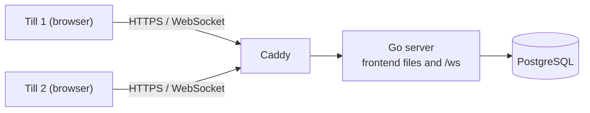
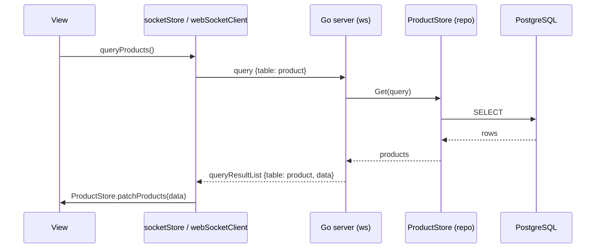
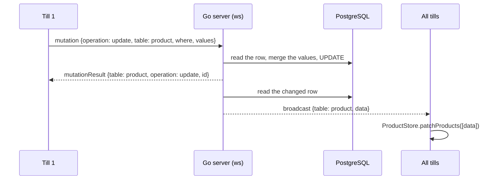

# Architecture

How AVHBS works: the parts of the system, the messages between them and the path a request takes.
Why it is built this way is in the [decision records](adr/README.md); the rules for writing code are in the `AGENTS.md` files.

## Overview

The Go server serves the built frontend and a single WebSocket endpoint, `/ws`; Caddy in front of it takes care of HTTPS.
Why: [ADR 0001](adr/0001-websocket-only-transport.md), [0002](adr/0002-postgresql-with-pgx-and-raw-sql.md), [0003](adr/0003-docker-compose-with-caddy.md).

## Message protocol

Every message is JSON of the form `{"type": …, "payload": …}`.
The schemas are in `schemas/`: `message.json` for the envelope, `sql/` for queries, mutations and their results, `db/` for the rows of single tables.

| Type | Direction | Payload |
|---|---|---|
| `ping`, `pong` | till → server, server → till | a timestamp; the till's heartbeat |
| `query` | till → server | a table, optionally filters, sorting and a limit |
| `queryResultList` | server → till | the table and the matching rows |
| `mutation` | till → server | an operation (`insert`, `update`, `delete`), a table, the key of the row (`where`) and the new values |
| `mutationResult` | server → till | the table, the operation and the ID of the affected row |
| `broadcast` | server → all tills | the table and the changed data |
| `error` | server → till | a code, a message and details |

An update sends only the fields that change; the server merges them into the stored row.

## Data flow

When the app starts, it queries all tables it needs (`getAllFromDb()` in `frontend/src/store/socketStore.ts`).

Loading the products:

Changing a product at one till:

